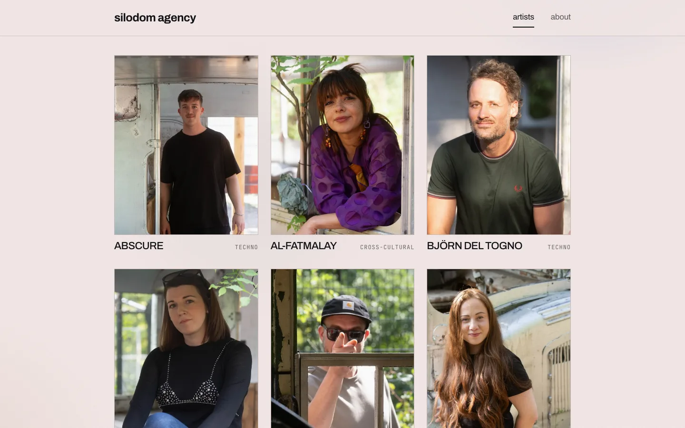
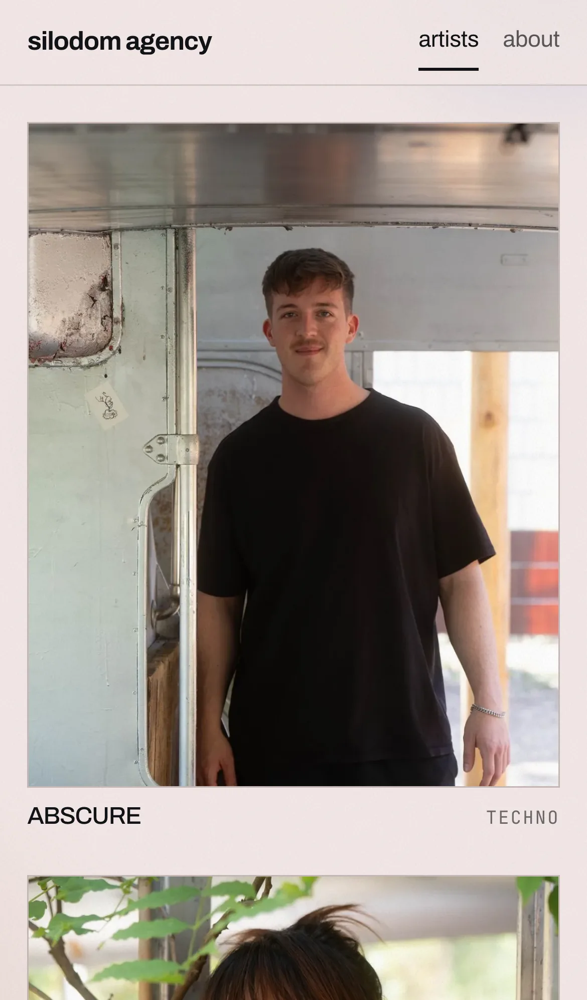

# silodom agency

Website for **silodom agency**, booking and artist management for electronic music in
Saarbrücken. Live at **[silodom-agency.com](https://silodom-agency.com)**.

| Desktop | Phone |
| --- | --- |
|  |  |

No backend, no CMS: the roster and the agency details are typed constants in `src/data/`,
and the site builds to static files on GitHub Pages. Every artist has an address of their own
(`/artists/<id>/`), prerendered at build time together with the sitemap.

**Stack:** Vite + React 18 + TypeScript, CSS Modules, no UI dependencies.

```bash
npm install
npm run dev        # http://localhost:5173
npm run check      # typecheck, data tests, build, browser tests
npm run build      # → dist/, with every route prerendered
```

**Lighthouse** on the live site (12.10.2026, Lighthouse 12.8):

| | Performance | Accessibility | Best practices | SEO |
| --- | --- | --- | --- | --- |
| Phone | 98 | 100 | 100 | 100 |
| Desktop | 100 | 100 | 100 | 100 |

Largest contentful paint 2.3 s on the throttled phone profile, 0.6 s on desktop; no layout
shift (CLS 0), because every photo is WebP in a fixed 4:5 frame.

**For the agency:** content changes do not need a developer. [`ANLEITUNG.md`](ANLEITUNG.md)
explains, in German, how to change text, photos or colours by telling Claude what you want;
the two skills in `.claude/skills/` carry out the request end to end.

---

## The pages

| Route | What is there |
| --- | --- |
| `/` | The roster as a grid of portraits, at most three per row, one on a phone. Every face is visible without hovering. Hovering or focusing a card draws a line under its image and nothing else; nothing is dimmed. Opening a card shows the artist's interview, genre and links in a panel. |
| `/artists/<id>/` | The same grid with that artist's panel open. Back closes the panel instead of leaving the site; an unknown id shows the roster. |
| `/about` | The agency: statement, services, contact. |
| `/impressum/`, `/datenschutz/` | Imprint and privacy notice, linked from the footer. |

Routing is a few lines in `src/lib/router.ts`: History API plus the View Transitions API
where the browser supports it. Two tabs did not justify a router dependency.

---

## Editing content

**`src/data/site.ts`**: agency name, descriptor, tagline, city, email, socials. The name feeds
the wordmark, `<title>`, footer and about copy.

**`src/data/artists.ts`**: the roster. Each artist answered the same interview; the questions
live once in `PROFILE_QUESTIONS`, the answers stay word for word. Photos go in
`src/assets/artists/` (4:5, about 1000 × 1250, WebP) and are imported there.

`npm test` checks the data on every run: unique URL-safe ids, a photo, a genre and at least
one answer per artist, https links only.

---

## Design

All of it is in `src/styles/tokens.css`.

- **Paper** `#f4e9e7`, a soft rosé, not white. **Ink** `#111216` at four opacities, each
  checked against the paper for contrast. The accent is the ink itself, kept as its own
  token in case a colour arrives later.
- **Photos** in colour and unedited.
- **Type:** Archivo Variable for display, JetBrains Mono Variable for labels; both
  self-hosted, so there is no external font request.
- **Motion:** one easing, three durations, all off under `prefers-reduced-motion`.

## Tests and CI

`tests/roster.spec.ts` and `tests/a11y.spec.ts` run in Playwright on a 1440px desktop, a
1024px laptop and an iPhone 13 (WebKit), plus Firefox for the custom scrollbar. They encode
the brief rather than the markup: every image painted on load, every fact reachable without
hover, keyboard operation, the panel's own address and back button, nothing moving under the
pointer, and axe without serious findings on every kind of page.

`.github/workflows/ci.yml` runs typecheck, data tests, build and the browser tests on every
pull request and push, with read-only permissions; `deploy.yml` publishes `main`. Both pin
every action to a reviewed commit.

## Deploying

Static output. `.github/workflows/deploy.yml` builds on every push to `main` and publishes
to GitHub Pages — no branch to maintain, no `dist/` in git.

Two things make the subpath work, and both are already wired up:

- **`base`** — Pages serves the site at `/<repo>/`, so `vite.config.ts` sets
  `base: '/absolut-agency/'` for production builds only; dev stays at `/`. The router reads
  `import.meta.env.BASE_URL`, so links and the back button follow automatically.
- **`404.html`** — Pages has no SPA rewrite, so a hard load of `/about` would 404. A build
  plugin copies `index.html` to `404.html`; Pages serves that for unmatched paths and the
  router resolves the route on boot.

Renaming the repo means updating the base path in `vite.config.ts` to match.

### Custom domain

Three things, in this order:

1. **DNS**, at the registrar. Apex (`silodom-agency.com`) needs four A records —
   `185.199.108.153`, `.109.153`, `.110.153`, `.111.153` — and optionally the matching
   AAAA records `2606:50c0:800{0,1,2,3}::153`. A subdomain (`www.silodom-agency.com`) needs a
   single CNAME to `benschuetze.github.io`. Propagation can take up to 24h.
2. **Tell GitHub**: `gh api -X PUT repos/benschuetze/absolut-agency/pages -f cname=silodom-agency.com`,
   then enable *Enforce HTTPS* once the certificate is issued (up to 24h).
3. **Set `CUSTOM_DOMAIN`** in `vite.config.ts` and push. A custom domain serves the site
   from `/`, so the base path must change in the same commit — the config derives one from
   the other so it cannot be half-done.

Do **not** add a `CNAME` file to `public/`. GitHub creates and reads that file only for
branch-based publishing; with an Actions workflow it is ignored, and having one around
just misleads whoever looks next.
